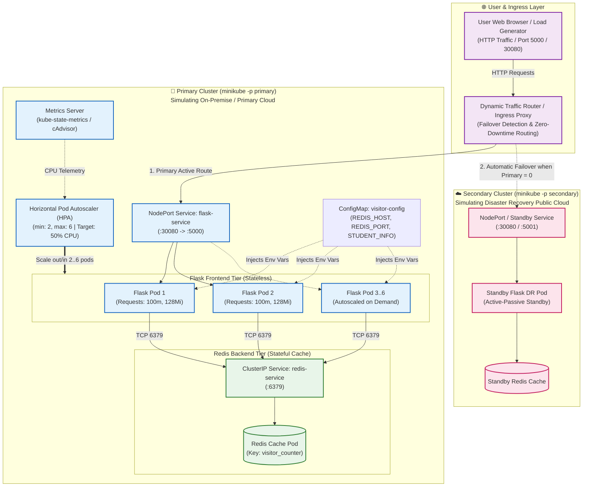
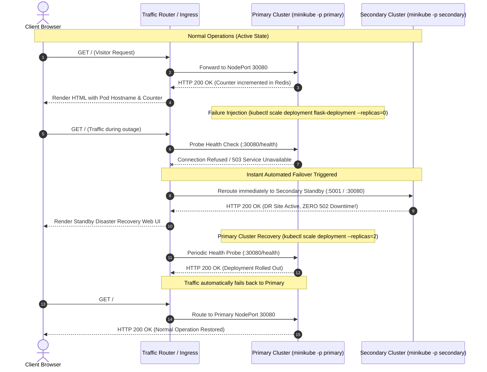
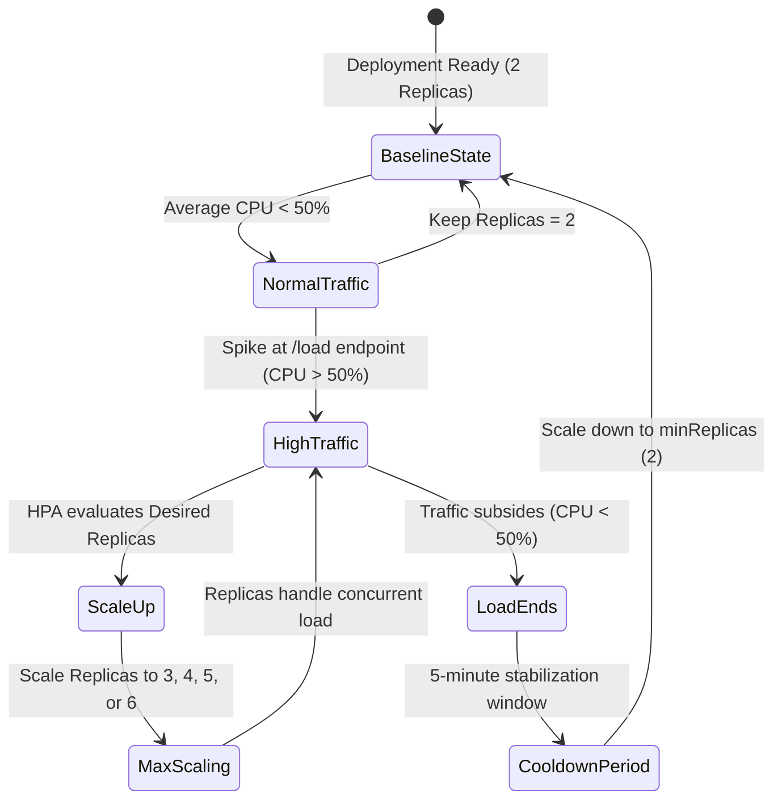

# Architecture Diagram & System Design Documentation

**Project Title:** Deploy a Visitor Counter Web App (Flask + Redis) on Docker and Kubernetes  
**Student:** Bhuwan Kumar (Roll No: 2410030358)  
**Course:** Cloud Computing & Distributed Systems  

---

## 1. System Architecture Diagram



---

## 2. Failover & Disaster Recovery Sequence Diagram



---

## 3. Horizontal Pod Autoscaler (HPA) Lifecycle Diagram



---

## 4. Visual ASCII Architecture Diagram

```
+========================================================================================+
|                                    HYBRID CLOUD TOPOLOGY                               |
|                  Student: Bhuwan Kumar | Roll No: 2410030358                           |
+========================================================================================+
                                            |
                                  [ User / Client Browser ]
                                            |
                                            v
                         +-------------------------------------+
                         |      Dynamic Traffic Router /       |
                         |      Zero-Downtime Failover Proxy   |
                         +-------------------------------------+
                                    /              \
         (Primary Active Path: 100%)                (Standby DR Path: Backup)
                    /                                                \
                   v                                                  v
+----------------------------------------+        +----------------------------------------+
| PRIMARY CLUSTER: minikube -p primary   |        | SECONDARY CLUSTER: minikube -p secondary|
| (Simulates On-Premise / Private Cloud) |        | (Simulates Public Cloud Standby DR Site)|
+----------------------------------------+        +----------------------------------------+
|                                        |        |                                        |
|  [ NodePort Service: flask-service ]   |        |  [ NodePort Service: flask-service ]   |
|         Port 30080 -> 5000             |        |         Port 30080 -> 5000 / 5001      |
|                   |                    |        |                   |                    |
|       +-----------+-----------+        |        |                   v                    |
|       v                       v        |        |      +--------------------------+      |
|  [Flask Pod 1]          [Flask Pod 2]  |        |      | Standby DR Flask Pod     |      |
|  (CPU: 100m)            (CPU: 100m)    |        |      | (Passive until failover) |      |
|  (RAM: 128Mi)           (RAM: 128Mi)   |        |      +--------------------------+      |
|       |                       |        |        |                   |                    |
|       +-----------+-----------+        |        |                   v                    |
|                   v                    |        |      +--------------------------+      |
|       [ClusterIP: redis-service]       |        |      | Standby Redis Store      |      |
|             Port 6379                  |        |      +--------------------------+      |
|                   v                    |        |                                        |
|         [( Redis Database Pod )]       |        |                                        |
|                                        |        +----------------------------------------+
|  ------------------------------------  |
|  [ Horizontal Pod Autoscaler (HPA) ]   |
|  * Min: 2 Replicas | Max: 6 Replicas   |
|  * Target CPU Utilization: 50%         |
|  * Scales Pods automatically via /load |
+----------------------------------------+
```

---

## 5. Architectural Component Reference Table

| Component | Technology | Role / Responsibility | Network Configuration |
|---|---|---|---|
| **Web Frontend** | Flask 3.1.3 (Python 3.10) | Serves UI, increments counter, exposes `/health` and `/load` | Container Port 5000, NodePort 30080 |
| **Data Cache** | Redis 7 Alpine | Stores high-speed persistent visitor count key | Container Port 6379, ClusterIP |
| **Config Store** | Kubernetes ConfigMap | Injects dynamic env vars (`REDIS_HOST`, student metadata) | Mounted via `envFrom` |
| **Autoscaler** | Kubernetes HPA (v2) | Automatically adjusts replica count between 2 and 6 | CPU threshold 50% |
| **Primary Cluster** | Minikube (`-p primary`) | Simulates enterprise production / on-premise cluster | Docker VM driver, 2 vCPUs, 2 GB RAM |
| **Secondary Cluster**| Minikube (`-p secondary`)| Simulates off-site public cloud disaster recovery site | Docker VM driver, 2 vCPUs, 2 GB RAM |
| **Health Probes** | Liveness & Readiness Probes | Detects container failures and triggers auto-recreation | HTTP GET `/health` every 5–10s |
